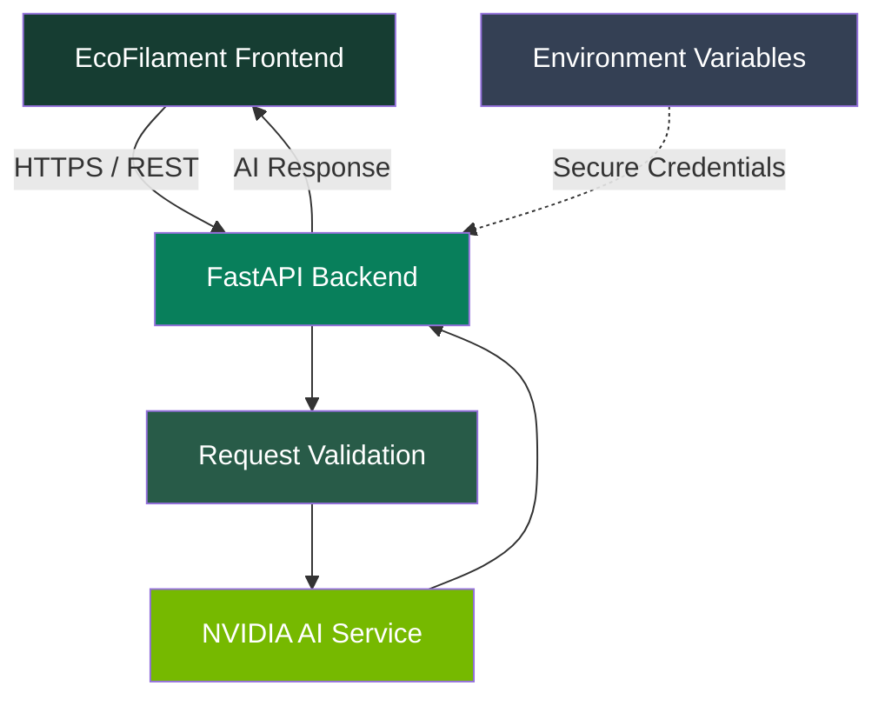

# 🌱 EcoFilament AI Backend

**The intelligent backend powering EcoFilament's educational experience.**

EcoFilament is an interactive educational project that explores the process of transforming recycled plastic into 3D-printing filament. This repository contains the FastAPI backend responsible for connecting the frontend to NVIDIA AI services securely.

<p align="center">
  
  
  
  
</p>

<p align="center">
  <a href="https://ecofilament-ai.enzonic.dev">Backend</a> ·
  <a href="https://ecofilament-ai.enzonic.dev/docs">API Documentation</a> ·
  <a href="https://ecofilament-ai.enzonic.dev/health">Health Check</a> ·
  <a href="https://github.com/Yassir050/EcoFilament">Main Repository</a>
</p>

---

## 📌 Overview

The backend acts as a secure communication layer between the EcoFilament frontend and NVIDIA AI services.

It handles incoming chat requests, validates conversation data, communicates with the AI provider, and returns responses to the frontend.

### Current Status

| Component | Technology |
|---|---|
| Backend Framework | FastAPI |
| Programming Language | Python 3.10+ |
| AI Provider | NVIDIA |
| AI Model | `nvidia/nemotron-3.5-bolt-e4b` |
| Hosting | Enzonic |
| Frontend | GitHub Pages |
| Communication | HTTPS / REST API |

---

## 🏗️ Architecture

The backend follows a simple client-server architecture.



### Security Architecture

- NVIDIA API credentials remain exclusively on the backend.
- The frontend never receives the NVIDIA API key.
- Requests are validated before processing.
- CORS is restricted to configured frontend origins.
- API communication uses HTTPS in production.

---

## ✨ Features

### 🤖 AI Chat

- NVIDIA-powered AI responses.
- Arabic and English conversation support.
- Conversation context maintained by the frontend during the current session.
- Incoming message and history validation.
- Request timeout handling.
- Controlled error responses.
- Restricted CORS configuration.

### ❤️ Health Monitoring

The backend exposes endpoints for monitoring service availability and configuration.

- Root service information.
- Backend health status.
- NVIDIA configuration status.

### 🔐 Credential Protection

Sensitive credentials are stored in server-side environment variables.

The NVIDIA API key must never be exposed in frontend code or committed to the public repository.

---

## 🔌 API Reference

Base URL:

```text
https://ecofilament-ai.enzonic.dev
```

| Method | Endpoint | Description |
|---|---|---|
| GET | `/` | Service information |
| GET | `/health` | Health and configuration status |
| POST | `/api/chat` | NVIDIA-powered AI Chat |
| GET | `/docs` | Interactive API documentation |

### Health Check

```http
GET /health
```

The endpoint reports the backend's operational status and whether NVIDIA credentials are configured.

**Important:** A successful health check does not guarantee that the external NVIDIA service is reachable.

### Interactive Documentation

Explore the actual request schemas, response formats, and validation rules through FastAPI Swagger UI:

[Open API Documentation](https://ecofilament-ai.enzonic.dev/docs)

---

## 📁 Project Structure

```text
backend/
├── main.py
├── requirements.txt
├── .env.example
├── .env                  # Local only - never commit
└── README.md
```

| File | Purpose |
|---|---|
| `main.py` | FastAPI application and API routes |
| `requirements.txt` | Python dependencies |
| `.env.example` | Environment configuration template |
| `.env` | Local environment secrets |
| `README.md` | Backend documentation |

---

## ⚙️ Getting Started

### Requirements

- Python 3.10 or newer.
- Internet connection.
- NVIDIA API key.
- Git (optional).

### 1. Clone the repository

```powershell
git clone https://github.com/Yassir050/EcoFilament.git
cd EcoFilament/backend
```

### 2. Create a virtual environment

```powershell
py -m venv .venv
```

### 3. Activate the environment

```powershell
.\.venv\Scripts\Activate.ps1
```

If PowerShell blocks activation, use the virtual environment's Python executable directly.

### 4. Install dependencies

```powershell
python -m pip install --upgrade pip
pip install -r requirements.txt
```

### 5. Configure environment variables

Create a local environment file:

```powershell
Copy-Item .env.example .env
```

Add your NVIDIA API key to `.env`:

```env
NVIDIA_API_KEY=your_nvidia_api_key
```

Replace the example value with your actual key.

**Never commit `.env` or expose its contents.**

### 6. Start the backend

```powershell
uvicorn main:app --reload
```

The local server will be available at:

```text
http://127.0.0.1:8000
```

---

## 🧪 Testing & Validation

Before deploying backend changes, verify the following:

- [ ] Backend starts successfully.
- [ ] Root endpoint responds correctly.
- [ ] Health check reports the expected status.
- [ ] Swagger documentation loads.
- [ ] AI Chat accepts valid requests.
- [ ] Arabic responses work correctly.
- [ ] English responses work correctly.
- [ ] Invalid requests return controlled errors.
- [ ] API credentials are not exposed.
- [ ] CORS configuration matches the intended frontend origins.

The frontend also has a separate Playwright end-to-end testing workflow through GitHub Actions.

---

## 🚀 Deployment

The production backend is hosted on Enzonic.

| Resource | Link |
|---|---|
| Production API | [ecofilament-ai.enzonic.dev](https://ecofilament-ai.enzonic.dev) |
| Health Check | [View Status](https://ecofilament-ai.enzonic.dev/health) |
| Swagger UI | [API Documentation](https://ecofilament-ai.enzonic.dev/docs) |
| Deployment Dashboard | [Enzonic Dashboard](https://deploy.enzonic.com/projects/01m7zt0vh8sdpf0kzfhyjhke94) |
| Frontend | [EcoFilament Website](https://yassir050.github.io/EcoFilament/) |

### Production Configuration

Configure `NVIDIA_API_KEY` through the Enzonic deployment environment settings.

Do not place production credentials in GitHub, frontend JavaScript, or public configuration files.

---

## 🛡️ Security Guidelines

Security is a core requirement of this backend.

- Keep API credentials exclusively on the server.
- Never commit `.env`.
- Restrict CORS to trusted frontend origins.
- Validate incoming messages and conversation history.
- Apply suitable request timeouts and request limits.
- Avoid logging confidential information.
- Rotate exposed credentials immediately.
- Remember that CORS is not a replacement for API authentication.

---

## 🗺️ Roadmap

| Feature | Status |
|---|---|
| Initial FastAPI backend | ✅ Completed |
| NVIDIA AI Chat integration | ✅ Completed |
| Arabic and English support | ✅ Completed |
| Frontend integration | ✅ Completed |
| Production deployment | ✅ Completed |
| Playwright test workflow | ✅ Implemented |
| NVIDIA-powered AI Presenter TTS | 🔜 Planned |
| Improved multilingual speech generation | 🔜 Planned |
| Advanced backend monitoring | 🔜 Planned |
| Additional production protections | 🔜 Planned |

### 🎙️ AI Presenter — Future Development

The current AI Presenter uses the browser's native `SpeechSynthesis` functionality.

NVIDIA-powered text-to-speech is a future development and is not currently integrated into the deployed backend.

---

## 🔧 Troubleshooting

### Backend does not start

Check:

- Python version.
- Installed dependencies.
- Current working directory.
- Port availability.
- Deployment logs.

### NVIDIA API request fails

Check:

- NVIDIA API key configuration.
- Credential validity.
- NVIDIA service availability.
- Request timeout settings.
- Backend error logs.

Never print API keys during debugging.

### CORS errors

Verify that the frontend's exact origin is included in the backend's allowed CORS origins.

CORS controls browser access; it does not authenticate API clients.

### Health check works, but AI Chat fails

The health endpoint confirms backend availability, not external AI provider availability.

Test the `/api/chat` endpoint independently.

---

## 🔗 Related Resources

- [EcoFilament Main Repository](https://github.com/Yassir050/EcoFilament)
- [EcoFilament Live Website](https://yassir050.github.io/EcoFilament/)
- [FastAPI Documentation](https://fastapi.tiangolo.com/)
- [NVIDIA Developer Platform](https://build.nvidia.com/)
- [Python Documentation](https://docs.python.org/3/)

---

<p align="center">
  <strong>🌱 EcoFilament</strong><br/>
  <sub>Turning plastic waste into possibilities.</sub>
</p>
